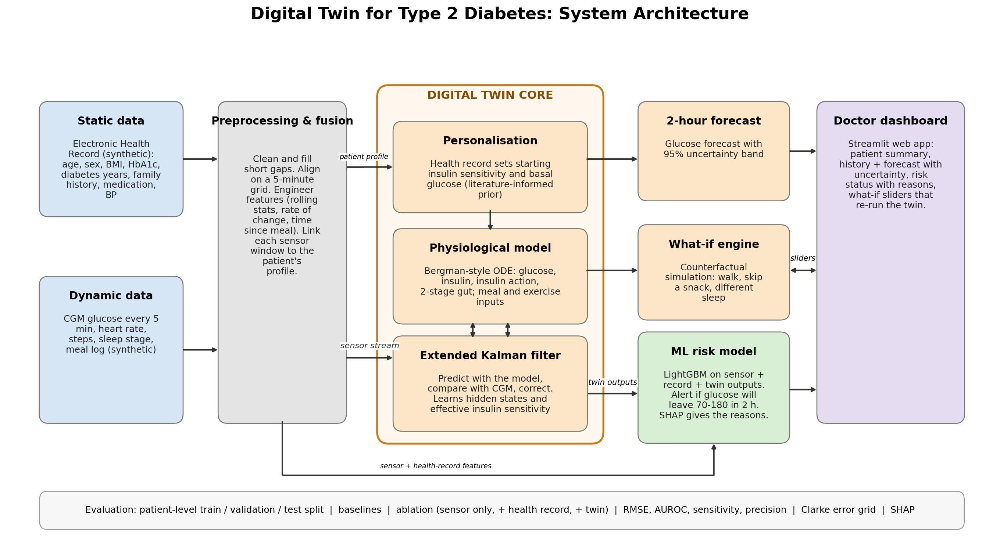
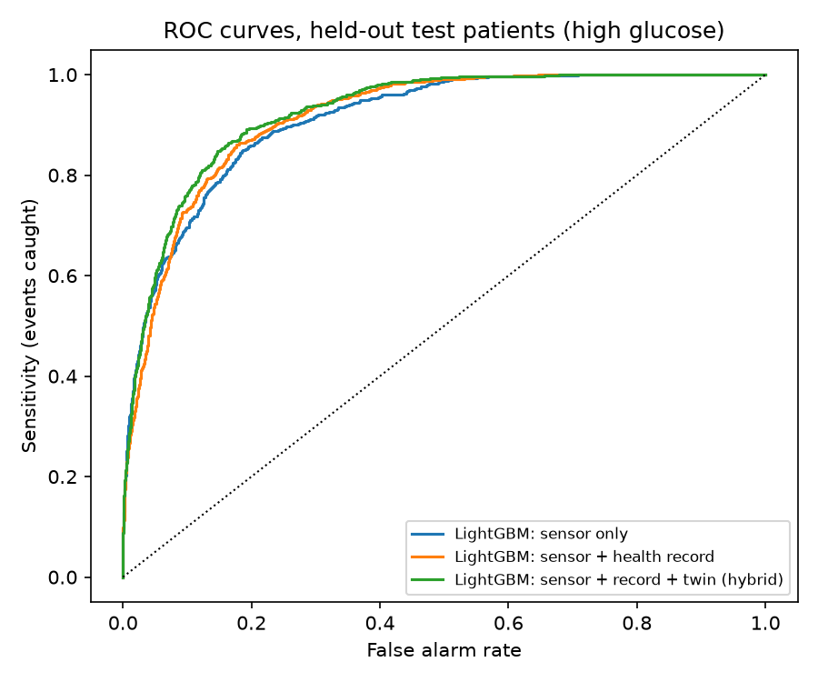
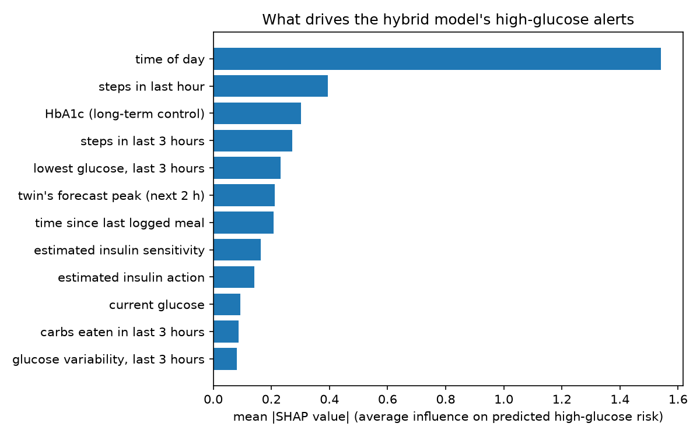
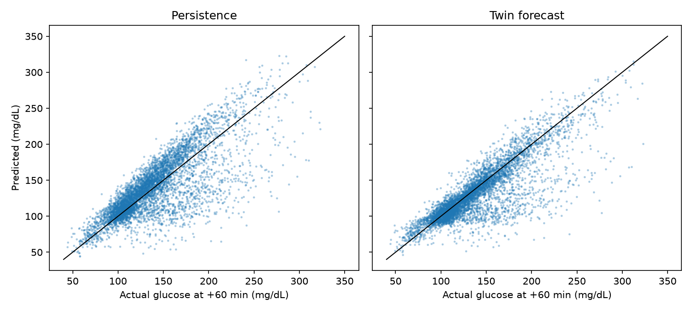

# TwinGlu: A Hybrid Digital Twin for Type 2 Diabetes

Submission for the Happiest Health **Digital Twin in Healthcare** challenge.

## Room209

| Ojasvini Dixit (team leader) | Digital twin: physiological model, Kalman filter, what-if engine |
| Arti Verma | Data and machine learning: features, risk model, evaluation |
| Muskan Narang | Dashboard, documentation and submission |

**College:** University School of Automation and Robotics | **Team name:** Room209

## Links

- Video demo (20+ min): [VIDEO LINK]
- Presentation: [docs/presentation.pdf](docs/presentation.pdf)
- Architecture diagram: [docs/architecture.pdf](docs/architecture.pdf)
- License: MIT (see [LICENSE](LICENSE))

## Problem and use case

India has one of the largest populations living with diabetes, and many people are poorly controlled. A doctor sees a patient every few months, but glucose changes minute by minute: a dangerous spike or drop can happen between visits and nobody sees it coming.

We built a **proof-of-concept digital twin** of a patient with **Type 2 Diabetes**: a virtual copy kept in sync with the patient's health record and wearable sensor data. It forecasts glucose for the next 2 hours, flags a likely dangerous high or low, explains why, and lets a doctor test changes (a walk after dinner, skipping a snack, less sleep) on the virtual patient before advising the real one.

## How it works



The twin follows a robotics idea: a model of the system, corrected by sensors, used to predict what happens next.

1. **Static data (EHR):** age, sex, BMI, HbA1c, diabetes duration, family history, medication, blood pressure.
2. **Dynamic data:** continuous glucose monitor (CGM) readings every 5 minutes, heart rate, steps, sleep stage and a meal log.
3. **Physiological model:** a Bergman-style set of differential equations for glucose, insulin, insulin action and a two-stage gut, driven by meals and exercise.
4. **Personalisation:** the health record sets the starting insulin sensitivity and basal glucose (a literature-informed prior, not a clinically validated mapping).
5. **Extended Kalman filter:** at every 5-minute step it predicts with the model, compares with the CGM and corrects the state. It also estimates an *effective* insulin sensitivity for each patient.
6. **Forecast:** the corrected model is rolled forward 2 hours, with an uncertainty band from the filter's covariance.
7. **ML risk model:** LightGBM takes sensor features, the health record and the twin's outputs and scores the risk of leaving 70 to 180 mg/dL in the next 2 hours. SHAP explains each alert.
8. **What-if engine:** re-runs the twin with a changed input (walk, snack, sleep) and compares the curves.
9. **Dashboard:** a Streamlit web app for the doctor.

### Modelling assumptions

- A meal logged at step k enters the stomach at the start of that 5-minute step; the transition from k to k+1 uses the carbs and exercise inputs at k.
- `forecast()` assumes **no future meals or exercise** unless a scenario provides them.
- Exercise intensity is derived from step counts (a brisk walk is about 500 steps per 5 minutes).
- About 10% of meals in the data are unlogged. The filter can absorb them only after they appear in the sensor.
- The effect of short sleep on insulin sensitivity (about 6% lower per hour under 7 h) is an **assumption**, not a validated result.

## Tech stack

Python 3 | NumPy, pandas, SciPy | scikit-learn, LightGBM, SHAP | Matplotlib | Streamlit, Plotly | Git/GitHub

## Data (synthetic) and ethics

All data is **synthetic**, as the challenge rules require, and complies with the spirit of the DPDP Act and HIPAA because no real person's data is used.

- `src/data/generate_data.py` creates the patient records and the 5-minute sensor data (60 patients, 14 days, seed 42).
- The generator deliberately uses a *different* mechanism from the twin's equations (gamma-shaped meal responses, drift, noise, dropouts), so the twin is not simply refitting its own model.
- Each patient's average glucose is calibrated to their HbA1c, with random mismatch.
- `data/patients_hidden.csv` holds the true insulin resistance used only to check the twin's estimates. It is never a model input.
- Effects of sleep and exercise in the generator are assumptions, not clinical findings.

This is a proof of concept to support a doctor, not replace one. It is not a medical device and has not been clinically validated.

## Results

Evaluation uses a **patient-level split** (about 70/15/15), so test patients are completely unseen. Re-create this section with `python src/make_results_md.py` after training.

<!-- RESULTS_START -->
**High glucose: will glucose go above 180 mg/dL in the next 2 hours?**

| Model | AUROC | 95% CI (resampling test patients) | Sensitivity | Precision |
|---|---|---|---|---|
| Rule: linear extrapolation | 0.63 | 0.58 to 0.66 | 0.69 | 0.21 |
| Twin physics only (forecast peak) | 0.68 | 0.59 to 0.74 | 0.67 | 0.24 |
| LightGBM: sensor only | 0.91 | 0.89 to 0.93 | 0.64 | 0.64 |
| LightGBM: sensor + health record | 0.92 | 0.89 to 0.94 | 0.69 | 0.63 |
| LightGBM: sensor + record + twin (hybrid) | 0.93 | 0.90 to 0.95 | 0.69 | 0.66 |
| SANITY: hybrid with SHUFFLED labels | 0.56 | n/a | n/a | n/a |

_Predicts new events only (patients currently at or below 180). Alert threshold chosen on validation patients to catch about 80% of events. Test set: 4707 moments, 800 events._

**Low glucose: will glucose go below 70 mg/dL in the next 2 hours? (EXPLORATORY)**

| Model | AUROC | 95% CI (resampling test patients) | Sensitivity | Precision |
|---|---|---|---|---|
| Rule: linear extrapolation | 0.84 | 0.69 to 0.88 | 0.74 | 0.08 |
| Twin physics only (forecast at +60 min) | 0.97 | 0.88 to 0.99 | 0.93 | 0.18 |
| LightGBM: sensor only | 0.94 | 0.74 to 0.98 | 0.86 | 0.25 |
| LightGBM: sensor + health record | 0.91 | 0.74 to 0.98 | 0.89 | 0.12 |
| LightGBM: sensor + record + twin (hybrid) | 0.92 | 0.89 to 0.99 | 0.90 | 0.23 |
| SANITY: hybrid with SHUFFLED labels | 0.61 | n/a | n/a | n/a |

_Low events are rare and come from very few patients in the synthetic data, so treat these rows as a prototype, not a result. Test set: 5464 moments, 163 events._

**Glucose forecast accuracy (held-out test patients)**

| Horizon (min) | Model | RMSE (mg/dL) | Clarke zone A | Clarke zones A+B |
|---|---|---|---|---|
| 30 | Persistence (glucose stays the same) | 17.0 | 93% | 100% |
| 30 | Twin forecast (no future meals assumed) | 14.6 | 95% | 100% |
| 60 | Persistence (glucose stays the same) | 28.1 | 79% | 99% |
| 60 | Twin forecast (no future meals assumed) | 24.9 | 86% | 99% |
| 120 | Persistence (glucose stays the same) | 41.3 | 52% | 97% |
| 120 | Twin forecast (no future meals assumed) | 37.1 | 72% | 97% |

_RMSE = average forecast error (lower is better). Clarke zones A and B are clinically safe errors. The twin forecast assumes no future meals or exercise._




<!-- RESULTS_END -->

**How to read these results**

- The hybrid model scores best for high-glucose alerts, but the differences between the three LightGBM variants are small and their confidence intervals overlap. With only a few test patients we cannot claim the health record or the twin features give a statistically significant gain.
- A label-shuffle sanity check (training on shuffled labels) scores near chance, which argues against data leakage.
- The twin's own forecast beats the "glucose stays the same" baseline at every horizon, and the gap grows when upcoming meals are known (see `results/twin_eval.txt`).
- The estimated insulin sensitivity is an *effective*, moderately informative quantity: it correlates negatively with the hidden true insulin resistance, but not perfectly (see `results/twin_eval.txt`).
- "Time of day" ranks high in the SHAP explanations because the synthetic generator places meals at fairly regular clock times. Real life is less regular.
- The alert threshold chosen on validation patients catches fewer events on the test patients than on validation, so alert quality varies between patients.
- The risk model was trained with balanced class weights, so its scores are **not calibrated probabilities**.

## Limitations

Synthetic EHR and sensor data; simplified physiology; assumed sleep and exercise effects; low-glucose prediction is exploratory; small number of test patients; no clinical validation.

## Future work

Validation on real, consented data with a hospital partner; live wearable streaming; other conditions common in India (hypertension, cardiovascular risk) with the same model-estimator-ML pattern; a patient-facing version.

## How to run

```bash
# 1. environment (Python [VERSION] used)
python -m venv .venv
.venv\Scripts\activate          # Windows;  macOS/Linux: source .venv/bin/activate
pip install -r requirements.txt

# 2. data, features, models (about 5 minutes)
python src/data/generate_data.py --n-patients 60 --days 14 --seed 42
python src/ml/build_dataset.py data
python src/ml/train.py data

# 3. dashboard
streamlit run app/dashboard.py
```

Optional: `python src/twin/evaluate_twin.py data 20 > results/twin_eval.txt` (twin accuracy and sensitivity recovery), `python src/twin/plot_patient.py data P001` (figures), `python docs/make_architecture.py` (architecture diagram).

## Repository structure

```
data/        synthetic data (patients, sensor, hidden truth)
src/data/    generate_data.py
src/twin/    model.py, kalman.py, twin.py, evaluate_twin.py, plot_patient.py, tune_sensitivity.py
src/ml/      features.py, build_dataset.py, train.py, risk.py
src/         pipeline.py (glue for the dashboard), make_results_md.py
app/         dashboard.py
results/     tables, figures, patient split
models/      trained LightGBM models
docs/        architecture diagram, presentation, figures
```

## License

MIT. See [LICENSE](LICENSE).
