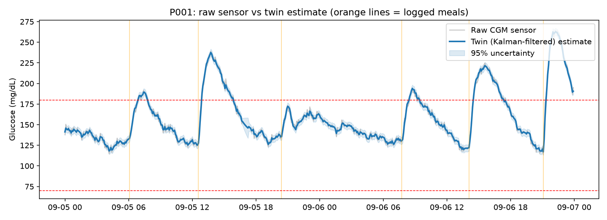
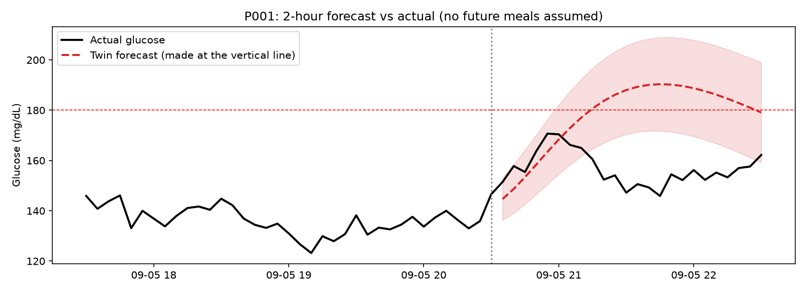
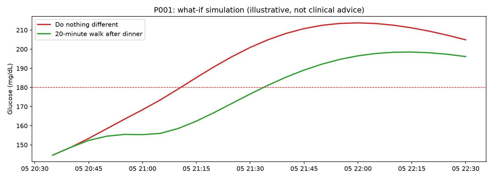

The twin was evaluated on 20 synthetic patients over 14 days. We compared its glucose forecasts against a persistence baseline, which assumes glucose stays at its current value.

| Forecast horizon | Persistence RMSE | Twin without future meals | Twin with upcoming meals known |
|---|---:|---:|---:|
| 30 minutes | 16.1 | 14.0 | 12.4 |
| 60 minutes | 26.6 | 24.0 | 16.6 |
| 120 minutes | 39.1 | 35.3 | 19.3 |

*RMSE is measured in mg/dL; lower values indicate more accurate forecasts.*

The twin without future meal information performed better than the persistence baseline at all three forecast horizons. Forecast accuracy improved further when upcoming meal information was supplied. This comparison uses known future meals and should therefore be interpreted as an informed scenario rather than a standard real-time forecast.

The correlation between the initial sensitivity estimate and true synthetic insulin resistance was −0.78. After filtering, it was −0.76. Both were negative, as expected, but filtering did not improve this correlation in this evaluation.

These are preliminary results from synthetic data and do not establish clinical accuracy.

## Evaluation Figures

### Figure 1: Glucose Estimation

This figure shows how the digital twin estimates glucose levels from sensor readings.

### Figure 2: Glucose Forecast

This figure compares the predicted glucose levels with the simulated actual glucose levels.

### Figure 3: What-if Walking Simulation

This figure compares predicted glucose levels with and without a simulated walk. For patient P001, the predicted peak decreased from 214 mg/dL to 199 mg/dL. This is a simulation result, not evidence of a real clinical effect.
